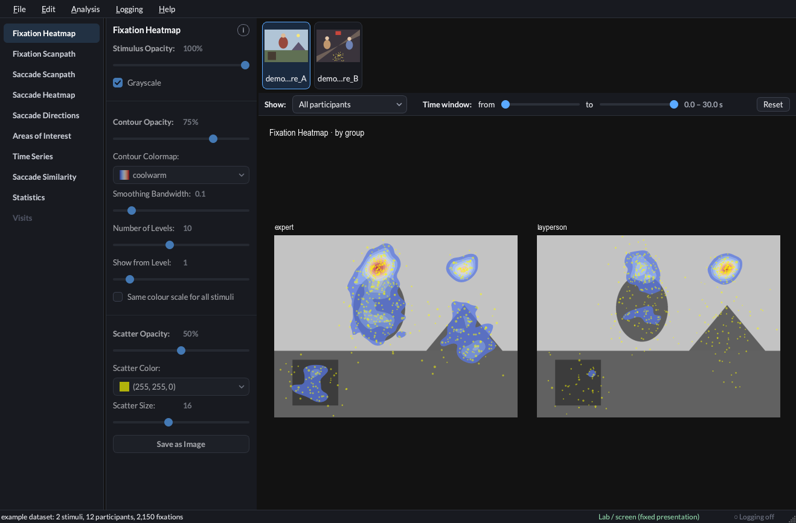
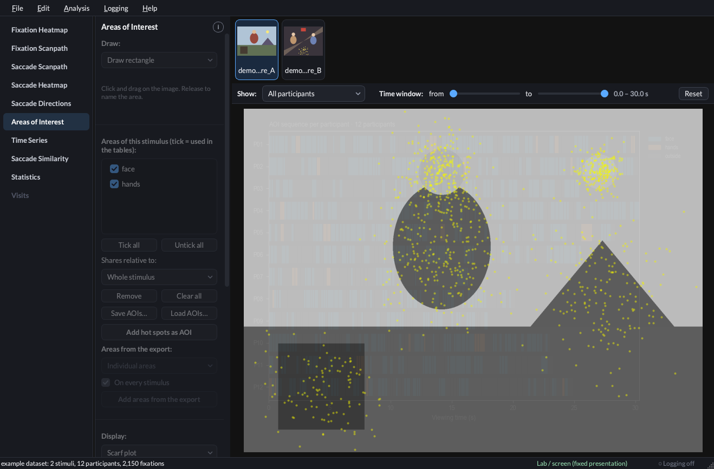
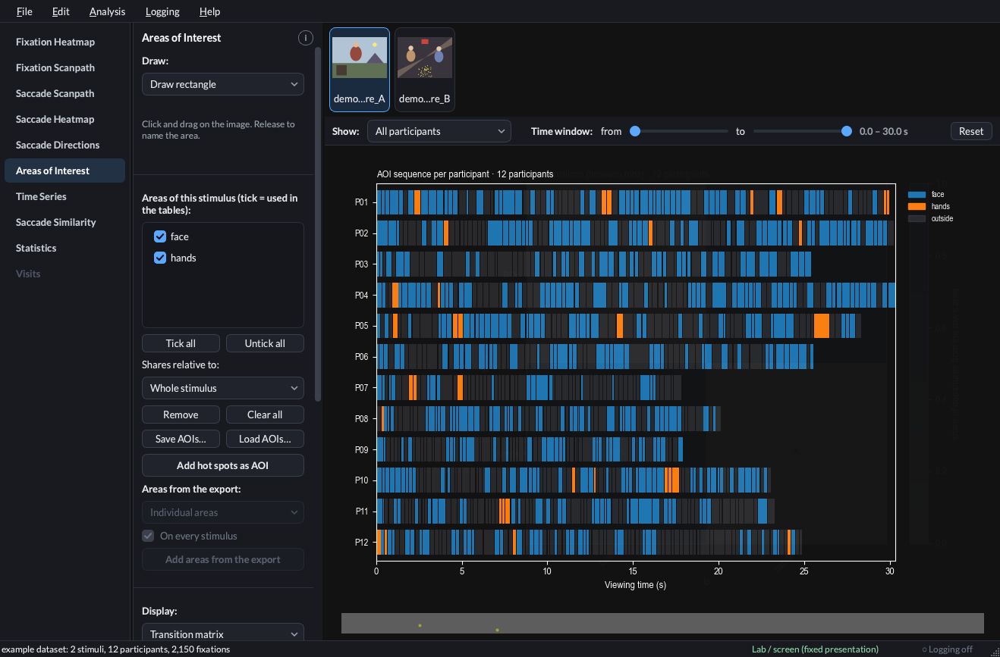
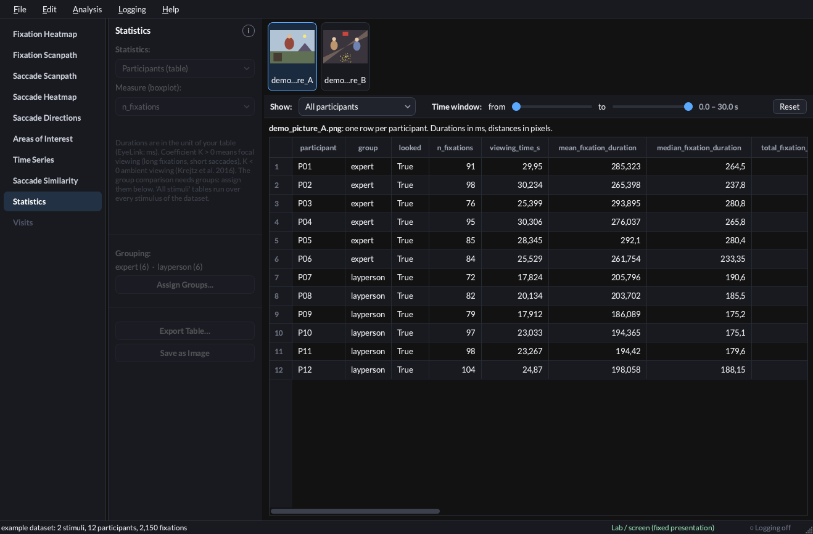

# creapy

`creapy` (pronounced /ˈkɹiə.paɪ/) is a toolbox for eye-tracking data from people looking at art. It shows where
viewers looked, for how long and in what order, and how groups of viewers differ, as figures and as tables. It is
developed at the [**CReA Lab** (Lab for Cognitive Research in Art History, Department of Art History, University
of Vienna)](https://crea.univie.ac.at/) for art historians who do not program, with a Python library underneath
for those who do.

- `creapy.io`, the desktop app: a program you download and start by double-click. It runs without Python and
  without an internet connection. Open a data file, click through the views, save the figures, export the tables.
- `creapy`, the library: everything the app shows is one documented Python call
  ([`docs/LIBRARY.md`](https://github.com/xysLong/creapy/blob/main/docs/LIBRARY.md), `tutorial.ipynb`).

Status: prototype in active use at the CReA Lab (current version in `CHANGELOG.md`); the API may still change before 1.0.
Presented as a poster at DHd 2026 (see Citation). Source: <https://github.com/xysLong/creapy> (MIT).

## Two kinds of eye tracking

`creapy` knows two recording settings and shows different things for each, because the data mean different things.

**In the lab (EyeLink and other screen-based trackers).** A person sits still in front of a screen. Every picture is shown
to everyone for the same number of seconds, in a known order, at the same distance. Viewers are directly
comparable: the first three seconds of one person are the first three seconds of everyone, a scanpath is one
uninterrupted path, and two scanpaths on the same picture can be matched against each other.

**In the museum (Tobii glasses).** Visitors walk through rooms wearing glasses. Their gaze is mapped afterwards
onto photographs of the walls (snapshots). Nobody sees the same thing for the same time: one visitor glances at a
painting for a second, another returns to it three times, a third never comes close. There is no "first three
seconds of the picture", only the first seconds of each *visit*; paths break whenever the visitor looks away
from the wall; and the same painting is a few pixels for a visitor at the back of the room and the whole snapshot
for one standing in front of it.

`creapy` picks the setting when a file is opened (EyeLink reports open in the lab setting, Tobii Pro Lab exports in
the museum setting; *Analysis > Recording Setting* switches it). In the museum setting,
scanpaths and saccades break between visits and at pauses, the time filter means "the first seconds of each
visit", a **Visits** view counts who came to which wall, how often and for how long, and the analyses that assume
one quiet viewing of fixed length (time series, similarity of whole viewing patterns, recurrence) are
greyed out, with the reason shown on hover. The saccade heatmap is greyed out there as well, because its smoothing is
set in pixels of a photograph that visitors saw from different distances. In the lab setting those analyses are available and Visits is greyed
out instead.

`creapy` is one of the CReA Lab's eye-tracking tools; the others, and the lab's work with eye-tracking glasses, are
described on its [Methods and Software](https://crea.univie.ac.at/projects/methods) page.

## Getting the app

Download `creapy.io-...-macOS.zip` (Macs with an Apple chip), `creapy.io-...-macOS-intel.zip` (Macs with an Intel chip;
both need macOS 14 or newer) or `creapy.io-...-Windows.zip` (Windows 10 or 11) from the
[releases page](https://github.com/xysLong/creapy/releases), unzip, double-click.
The first start needs one extra click in a security dialog:
[`docs/INSTALL_APP.md`](https://github.com/xysLong/creapy/blob/main/docs/INSTALL_APP.md) walks through it.

The start screen offers three ways in:

- **Open a bundle**: one `.creapy` file holding ready-made projects, data, images and areas of interest included.
  This is how a lab hands a dataset to people who should not have to assemble it themselves: choose
  the file, and the project opens.
- **Example dataset**: twelve invented viewers on two generated pictures, so every view can be tried before any
  real data is at hand.
- **Import your own data**: a fixation table plus the folder with the images (see Data formats below).

## What you can see



- **Where people looked.** The fixation heatmap is a weather map of attention: warm where many viewers rested
  their eyes for long, cold where nobody did. A slider sets how blurred the map is.
- **In what order.** The scanpath draws one viewer's fixations as numbered dots joined by lines; the saccade
  scanpath draws only the jumps. Pick one viewer or a group.
- **In which direction the eyes travel.** A rose diagram shows whether viewers scan a picture sideways, up and
  down, or along a diagonal.
- **How long on which part.** Draw rectangles or polygons on the picture (or take the areas that Tobii Pro Lab
  already defined) and read off dwell time, number of looks, time to first look, the order in which areas were
  entered, and how often the gaze moved from one area to another.
- **Who differs from whom.** Assign viewers to groups (experts and novices, two conditions, any column of a
  participant table) and **Compare Side by Side** draws the heatmaps, scanpaths,
  directions, areas and statistics once per group, picture or time window.
  The Statistics view gives the numbers behind the pictures and a test of the difference.
- **Who came back** (museum only). A timeline of every visitor's visits to every wall, totals per visitor and
  wall, who looked at a painting at all, and in which order the walls were seen.

| | | |
|---|---|---|
|  |  |  |
| which area when, per viewer | moves between areas | the numbers, ready to export |

Every panel has **Save as Image** (PNG, PDF, SVG) and every table **Export Table** (CSV, Excel), so whatever goes
beyond the app can continue in Excel, R or Python. **Export This View for All Stimuli** writes a view once per
picture into a folder. *Help > The Analyses Explained* describes every measure in plain words, and
[`docs/QUICKSTART.pdf`](https://github.com/xysLong/creapy/blob/main/docs/QUICKSTART.pdf) is the two-page hand-out.

Lab recordings offer more views: the orientation-aware saccade heatmap and the HeatMatch similarity of saccade
patterns, and time series of fixation duration, pupil size or coefficient K over the viewing time. Two more,
scanpath comparison (MultiMatch, ScanMatch) and recurrence analysis, appear under *Analysis > Show Advanced
Analyses*. The app keeps a session log of what you do in it (views, parameters, clicks, dialogs, errors) as a text
file on your own computer only; *Logging > Save Logs for a Bug Report* packs it for a report, and the *Logging* menu
switches it off.

## Data formats

| Source | What to export | Notes |
|---|---|---|
| **Tobii Pro Lab** (glasses) | *Event-based metrics export* (TSV, one row per fixation) or the *Data export* (one row per gaze sample) | each snapshot becomes one stimulus; for the event-based export, the *AOI-based metrics export* of the same project adds the recording clock (visits in real time) and the areas nobody looked at |
| **EyeLink DataViewer** | *Fixation report* or *Saccade report*, CSV/Excel, one row per event | needs a column with the stimulus image name; trial index and pupil size are picked up |
| **Anything else** | one row per fixation: participant, stimulus, start time, duration, x, y | CSV with `;` or tab (decimal commas fine) or with `,`; map the columns in the import dialog |

Coordinates are pixels of the image you provide (use the Pro Lab snapshots or the images at the shown
resolution); the time unit (s, ms or µs) is guessed from the values, so check
the durations in Statistics once. **Projects** remember the table, images, mapping, groups and
areas; a zip archive of a folder of projects, renamed to the suffix `.creapy`, is a **bundle** that others open
with one click.

## For programmers

```bash
pip install "creapy[gui]"    # library + desktop app (Python 3.10 or newer)
pip install creapy           # library only, no Qt
creapy-io                    # start the app; or: python -m creapy.io
```

```python
import creapy

df, mapping = creapy.load_fixations("fixation_report.csv")          # EyeLink, Tobii or any table
datasets = creapy.datasets_by_stimulus(df, mapping, "stimuli/")     # {stimulus -> (FixationData, SaccadeData)}
fix, sac = next(iter(datasets.values()))

import matplotlib.pyplot as plt
fig, ax = plt.subplots()
fix.make_heatmap(ax, bw_method=0.1, cmap="coolwarm")                 # the Fixation Heatmap view
fix.set_top_down_aoi("face", creapy.AOI.rectangle("face", 600, 100, 800, 300).geom)
print(fix.aoi_metrics())                                             # participant x area: dwell, looks, latency
grouping = {p: "expert" if i < 6 else "novice" for i, p in enumerate(fix.subjects)}
creapy.group_comparison(creapy.participant_table(fix, sac), grouping)
```

Mobile recordings: `creapy.load_prolab_event_export`, `attach_intervals` for the recording clock,
`visit_table`, `episodes`, `stimulus_totals` and `session_summary` in `creapy.stats.visits`.
[`docs/LIBRARY.md`](https://github.com/xysLong/creapy/blob/main/docs/LIBRARY.md) maps every view of the app to
its library call; `tutorial.ipynb` and `demo_similarity.ipynb` run on the example dataset.

Development: `pip install -e ".[dev]"` and `pytest` (formats, datasets, offscreen GUI). Layout: `creapy/formats/`
(readers, Tobii loaders), `creapy/gaze/` (datasets), `creapy/aoi/`, `creapy/stats/`, `creapy/similarity/`,
`creapy/io/` (the Qt app), `creapy/examples/` (synthetic data), `tests/`, `docs/`, `packaging/` (the app
bundles, built by the GitHub workflow). Saccade orientation fields and similarity come from the
[`heatmatch`](https://github.com/xysLong/HeatMatch) package and are not reimplemented here.

## Citation

Long, Xingyu, and Raphael Rosenberg. 2026. "Perspektiven für ein anfängerfreundliches Tool zur
Eye-Tracking-Datenvisualisierung in der kognitiven Kunstgeschichte." In *Book of Abstracts - DHd 2026: Not Only
Text, Not Only Data*, edited by Silke Schwandt, Gabriel Viehhauser, Tara Andrews, and Thomas Wallnig, 606–607.
https://doi.org/10.5281/zenodo.18703017.

Long, Xingyu, Jozsef Arato, Sophia Kury, Anna Miscena, and Raphael Rosenberg. 2026. "HeatMatch: Orientation-Aware
Visualization and Comparison of Very Dense Saccade Patterns." *Proceedings of the ACM on Computer Graphics and
Interactive Techniques* 9 (2): Article 18. https://doi.org/10.1145/3803539.

## License

MIT (see `LICENSE`). The desktop app bundles the Lato typeface (SIL Open Font License 1.1,
`creapy/io/style/fonts/OFL.txt`). Contact: Xingyu Long, xingyu.long@univie.ac.at.
